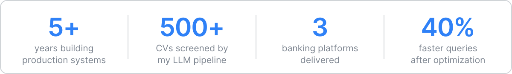

<picture>
  <source media="(prefers-color-scheme: dark)" srcset="./assets/banner-dark.svg">
  
</picture>

  <a href="https://sourabhossain.github.io/"><b>Portfolio</b></a> &nbsp;·&nbsp;
  <a href="https://www.linkedin.com/in/sourabhossain/"><b>LinkedIn</b></a> &nbsp;·&nbsp;
  <a href="mailto:sourab.career@gmail.com"><b>sourab.career@gmail.com</b></a>

Software Specialist at **SSL Wireless**. I design and ship backend systems and LLM products, from APIs and queues to RAG pipelines, across SaaS, healthcare, banking, recruitment and e-commerce.

### Selected work

<table>
  <tr>
    <td width="30%"><b>AI Recruitment Platform</b> SSL Wireless</td>
    <td>LLM resume screening in production across 8 job families, grown into a full hiring platform with approvals, ATS scoring and 11 user roles. <code>Django</code> <code>LangGraph</code> <code>Celery</code></td>
  </tr>
  <tr>
    <td><b>Banking Platforms</b> NRB Click, BASIC Bank, SBAC Bank</td>
    <td>Mobile and corporate banking backends with BEFTN, NPSB, RTGS, card and QR payments. <code>Laravel</code> <code>OAuth2</code> <code>JWT</code></td>
  </tr>
  <tr>
    <td><b>Workspace Platform</b> Othership</td>
    <td>Booking, membership and resource allocation backend. Cut query time by 40% by reworking queries and indexes. <code>REST</code> <code>RBAC</code></td>
  </tr>
  <tr>
    <td><b>NoSQL Query Parser</b> Groots Inc.</td>
    <td>Custom query parser adopted by 3 teams that cut complex query times by 30%, plus a monolith to microservices migration. <code>Node.js</code> <code>Microservices</code></td>
  </tr>
</table>

### Open source

- [**Invoice Intake**](https://github.com/sourabhossain/invoice-intake): reads supplier invoices with a vision model and posts only verified entries
- [**JiggasAI**](https://github.com/sourabhossain/JiggasAI): a RAG agent with streaming chat and web search, running on local models
- [**Prompt Vault**](https://github.com/sourabhossain/prompt-vault): a Chrome extension, live on the Web Store

### Stack

