<picture>
  <source media="(prefers-color-scheme: dark) and (max-width: 600px)" srcset="./assets/hero-mobile-dark.svg">
  <source media="(max-width: 600px)" srcset="./assets/hero-mobile-light.svg">
  <source media="(prefers-color-scheme: dark)" srcset="./assets/hero-dark.svg">
  
</picture>

<picture>
  <source media="(prefers-color-scheme: dark) and (max-width: 600px)" srcset="./assets/activity-mobile-dark.svg">
  <source media="(max-width: 600px)" srcset="./assets/activity-mobile-light.svg">
  <source media="(prefers-color-scheme: dark)" srcset="./assets/activity-dark.svg">
  
</picture>

  <a href="https://sourabhossain.github.io/">Website ↗</a>&nbsp;&nbsp;&nbsp;
  <a href="https://www.linkedin.com/in/sourabhossain/">LinkedIn ↗</a>&nbsp;&nbsp;&nbsp;
  <a href="mailto:sourab.career@gmail.com">Email ↗</a>

