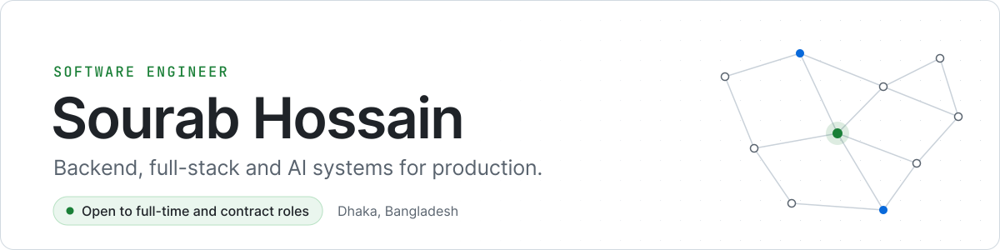

<picture>
  <source media="(prefers-color-scheme: dark)" srcset="./assets/banner-dark.svg">
  
</picture>

  <a href="https://sourabhossain.github.io/">Portfolio</a> &nbsp;·&nbsp;
  <a href="https://www.linkedin.com/in/sourabhossain/">LinkedIn</a> &nbsp;·&nbsp;
  <a href="mailto:sourab.career@gmail.com">sourab.career@gmail.com</a>

I'm a software engineer based in Dhaka with 5+ years of building and running production systems. Most of that time has been on the backend: APIs, background jobs, data pipelines, and the third-party integrations a product depends on. I now work across the frontend too, and a growing part of my work is LLM features that have to behave in production, not only in a demo.

I've shipped software for banking, SaaS, healthcare, recruitment, workspace management, and e-commerce.

## Selected work

**AI recruitment platform** · SSL Wireless 
An LLM resume screening pipeline, now in production, that replaced manual first-pass screening of 500+ CVs across 8 job families. A base-plus-fragment prompt design keeps scoring consistent across roles, with multi-tenant subdomain isolation and sentinel-based prompt-injection defense. It later grew into a full hiring platform: requisitions with dual approval, ATS scoring, interview and onboarding tracking, and role-based access across 11 roles. 
`Django` `Celery` `LangGraph` `OpenAI`

**Workspace management platform** · Othership 
Backend APIs and admin modules for hybrid workplace booking, memberships, and resource allocation. Restructured queries and indexed the hot paths to cut query time by 40%, and built third-party automations that save clients about 10 hours a week. Role-based access across member, admin, and operator roles. 
`REST APIs` `RBAC` `Query optimization`

**Banking and payments** · NRB Click, BASIC Bank, SBAC Bank 
Backend APIs and admin modules for mobile and corporate banking on a layered Laravel service architecture, covering BEFTN, NPSB, and RTGS transfers and integrations with core banking, payment and SMS gateways, QR, and card payments. Also built PaySync, an event-driven reconciliation system that replaced manual matching of about 500 daily payments, with data coming in from OCR, email, and SMS. 
`Laravel` `NestJS` `OAuth2` `JWT` `Queues`

**Query parser and microservices** · Groots Inc. 
For a Japan-market SaaS product: a custom NoSQL query parser, adopted by 3 teams, that cut complex query times by 30%. Moved core monolith logic into microservices so teams could deploy independently, and built an automated REST API pipeline that raised developer productivity by 50%. 
`Node.js` `NoSQL` `Microservices`

## Side projects

| Project | What it does | Stack |
|---|---|---|
| [Invoice Intake](https://github.com/sourabhossain/invoice-intake) | Reads Japanese supplier invoices with a vision model, recomputes every number locally, and posts only what it can prove to the accounting API. Everything else goes to a human, with a reason. | Python |
| [JiggasAI](https://github.com/sourabhossain/JiggasAI) | A personal RAG agent with streaming chat, web search, conversation memory, and PDF preview, running on local models through Ollama. | Django, LangGraph, ChromaDB |
| [Prompt Vault](https://github.com/sourabhossain/prompt-vault) | Chrome extension, live on the Web Store. Type `//` in any text field to insert a saved prompt. Nothing leaves the browser. | TypeScript |
| [Grocery Booking System](https://github.com/sourabhossain/grocery-booking-system) | Grocery ordering REST API with JWT refresh rotation, CI, and 80%+ test coverage. | NestJS, MySQL, Redis |
| [MongoDB Query Parser](https://github.com/sourabhossain/mongodb-query-parser) | Turns MongoDB REST APIs into Graph APIs. | Node.js |
| [Lisp to JS Compiler](https://github.com/sourabhossain/lisp-to-js-compiler) | Parses a Lisp-like syntax, transforms the AST, and emits runnable JavaScript. | JavaScript |

## Toolkit

| Area | Tools |
|---|---|
| Languages | TypeScript, JavaScript, Python, PHP |
| Backend | Node.js, NestJS, Express, Django, Laravel, REST, microservices |
| Frontend | React, Next.js, Tailwind CSS |
| AI | LangGraph, RAG pipelines, OpenAI, Ollama, ChromaDB, prompt engineering |
| Data | MySQL, PostgreSQL, MongoDB, Redis |
| Infrastructure | AWS (EC2, S3), Docker, Nginx, GitHub Actions |
| Security | OAuth2, JWT, RBAC, AES encryption |
| Patterns | Event-driven and queue-based systems, repository-service layering |

## Experience

| Role | Company | Period |
|---|---|---|
| Software Specialist | SSL Wireless | 2023 to 2026 |
| Software Engineer | Groots Inc. | 2021 to 2023 |

B.Sc. in Computer Science and Engineering, Southeast University, 2025

## Recognition

- Champion, SEU Intra Summer Programming Contest, SEU ICT Club
- Second Runner-Up, Inter Polytechnic Programming Contest, Bangladesh Open Source Network
- Champion, FCI Inter-Programming Contest, FCI ICT Club
- Speaker at SSL Wireless's company-wide AI knowledge-sharing series

---

Open to backend, full-stack, and AI engineering roles, full-time or contract, in Dhaka, remote, or abroad. Email is the fastest way to reach me.
